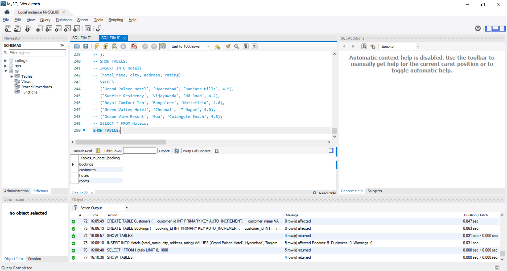
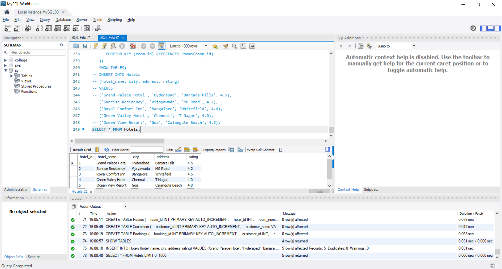
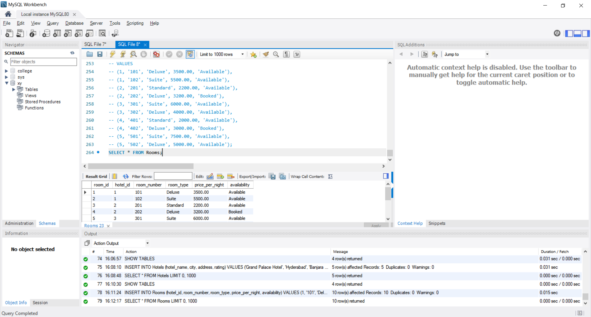
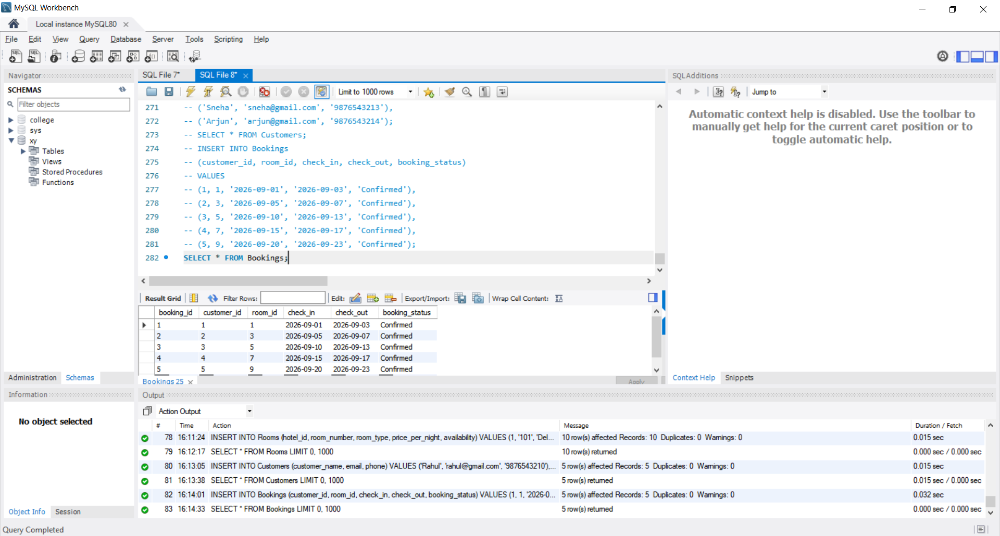
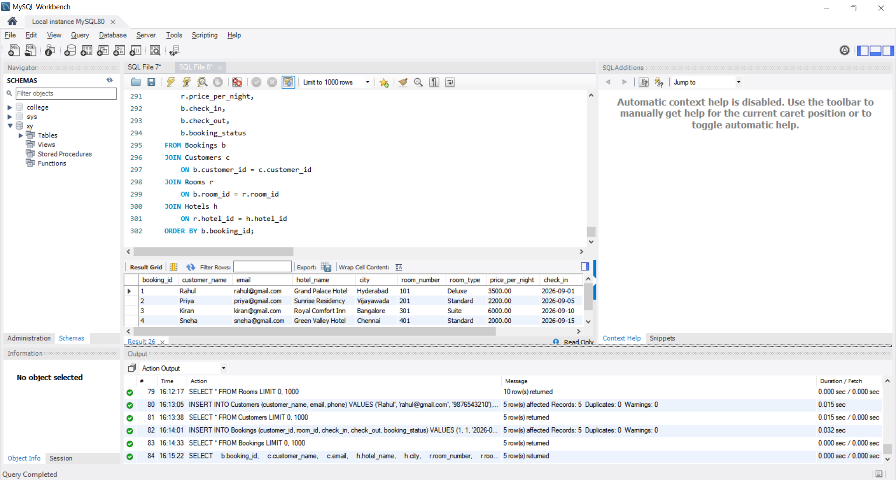
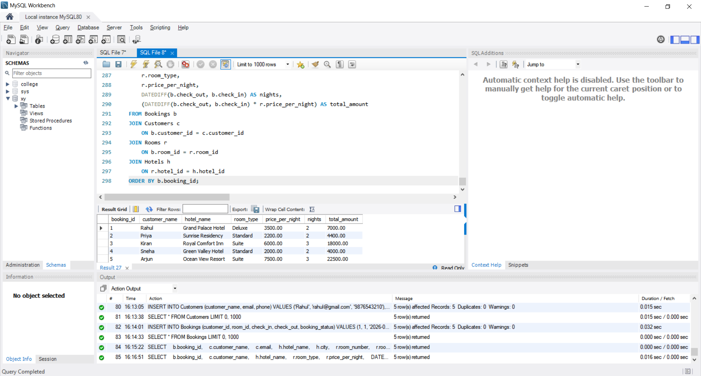

# CODTECH Internship Task-4

## Hotel Booking Database

**Company:** CODTECH IT SOLUTIONS

**Intern Name:** GOGULAPATI LAKSHMI POORNIMA

**Intern ID:** CTIS9030

**Domain:** SQL

**Duration:** 12 Weeks

**Mentor:** Neela Santosh kumar

## Objective

The objective of this project is to develop a Hotel Booking Database using MySQL.

The project focuses on:

* Managing hotel information
* Managing room information
* Managing customer information
* Managing hotel bookings
* Generating booking reports
* Calculating booking costs based on the number of nights

## Description

This project implements a Hotel Booking Database using MySQL. The system contains four tables: Hotels, Rooms, Customers, and Bookings.

SQL queries are used to store hotel, room, customer, and booking information and to generate complete booking reports and booking cost calculations.

## Database Tables

### Hotels

Stores hotel information including Hotel ID, Hotel Name, City, Address, and Rating.

### Rooms

Stores room information including Room ID, Hotel ID, Room Number, Room Type, Price per Night, and Availability.

### Customers

Stores customer information including Customer ID, Customer Name, Email, and Phone.

### Bookings

Stores booking information including Customer, Room, Check-in Date, Check-out Date, and Booking Status.

## Booking Cost Calculation

**Total Amount = Number of Nights × Price Per Night**

The number of nights is calculated using the MySQL `DATEDIFF()` function.

## Features

* Hotel data management
* Room data management
* Customer data management
* Booking management
* Booking status tracking
* Booking report generation
* Number of nights calculation
* Total booking cost calculation
* Relational database using foreign keys

## Tools Used

* MySQL
* MySQL Workbench
* SQL

## Files in Repository

* `Task_4_Hotel_Booking_Database.sql`
* `README.md`
* `Screenshots/SS_1_Database_Tables.png`
* `Screenshots/SS_2_Hotels_Data.png`
* `Screenshots/SS_3_Rooms_Data.png`
* `Screenshots/SS_4_Bookings_Data.png`
* `Screenshots/SS_5_Booking_Report.png`
* `Screenshots/SS_6_Booking_Cost.png`

# Proof of Execution

## SS 1 — Database and Tables

## SS 2 — Hotels Data

## SS 3 — Rooms Data

## SS 4 — Bookings Data

## SS 5 — Booking Report

## SS 6 — Booking Cost

## Conclusion

The Hotel Booking Database was successfully implemented using MySQL.

The project successfully manages hotels, rooms, customers, and bookings. The system generates booking reports and calculates the total booking amount based on the number of nights and room price.
